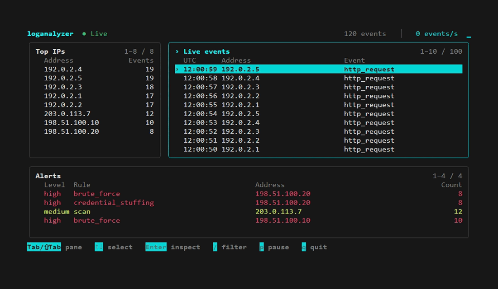
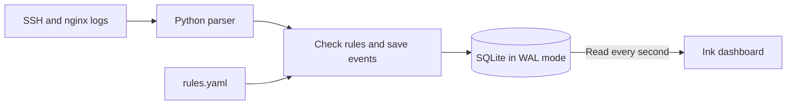

# loganalyzer

A small terminal dashboard for SSH and nginx logs. See which IPs are active, spot repeated login failures or web scans, and press **Enter** to read the log line behind an event.

This is a personal project for learning. All demo logs are generated. Use it only with logs you own or have permission to analyze.



[Still image](docs/media/dashboard.png) · [Python walkthrough](docs/PYTHON_WALKTHROUGH.md) · [Detection rules](rules.yaml)

## Try the demo

With Docker and Compose installed, run this from the project folder.

```sh
docker compose up
```

The demo replays about two minutes of logs in 24 seconds. You’ll see **120 events and four alerts**. To use the keyboard, open a second terminal and run `docker compose attach demo`. Press `q` to quit and run `docker compose down` to clean up. The demo database is temporary.

| Key | What it does |
| --- | --- |
| Tab / Shift+Tab | Switch panes. Each pane remembers your place. |
| ↑ / ↓ | Select a row or scroll through its details. |
| Enter / Esc | Open a row with Enter. Close it with Enter or Esc. |
| / | Filter by text, such as an IP. Enter applies the filter and resumes live updates. |
| p / q | Pause or resume with p. Quit with q. |

On a small terminal, the dashboard shows one pane at a time. Severity labels also work with `NO_COLOR=1`.

## Run it locally

**Load the sample logs.** Install Python 3.12 and uv, then run these commands from the project folder. The generator replaces `auth.log` and `access.log` in `samples/`.

```sh
uv sync --locked
uv run python scripts/generate_logs.py samples
uv run loganalyzer ingest samples/auth.log
uv run loganalyzer ingest samples/access.log
uv run loganalyzer stats
```

**Open the dashboard.** With Node 20+ and npm installed, run the following in a second terminal.

```sh
cd tui
npm ci
npm run build
npm start
```

The dashboard reads `../loganalyzer.sqlite3`. Use `npm start -- PATH` to open another database.

**Follow or replay a log.** Run either command from the project folder.

```sh
uv run loganalyzer watch samples/auth.log samples/access.log
uv run loganalyzer replay samples/auth.log --speed 10 --db demo.sqlite3
```

`ingest` and `watch` remember where they stopped. `replay` starts at the beginning and adds events each time. Use a fresh database for a fresh demo. For unusual filenames, pass `--format auth` or `--format nginx`.

## How detection works



The Python core saves events, alerts and the file position together. After a restart, it picks up at the last saved position. The dashboard opens the database read-only.

Each rule checks **one IP** over a time window. Edit `window_seconds`, the thresholds and `severity` in `rules.yaml`, or pass `--rules PATH` to use your own file.

| Rule | Default trigger within 60 seconds |
| --- | --- |
| Brute force | 6 failed SSH passwords |
| Credential stuffing | Failed passwords for 5 different usernames |
| Web scan | 8 HTTP 404 responses or 10 different paths |

One burst updates the same alert while the rule stays active. The sample produces four alerts because one IP triggers both SSH rules.

## Tests and speed

```sh
uv run pytest
uv run ruff check .
uv run mypy --strict
uv run pytest tests/benchmarks --benchmark-only
```

For the dashboard, run `npm test`, `npm run lint` and `npm run typecheck` from `tui/`.

**26,691 lines per second** was the median on Windows with Python 3.12.10 and an Intel Core i5-11400H. Each of five runs loaded 5,000 generated nginx lines into a fresh SQLite database. The median run took 187.33 ms, including parsing, detection and writes in batches of 500.

## Limits and ideas for later

- SSH logs leave out the year. The CLI assumes UTC and uses the file’s modification time as a starting point. A date and timezone option would help with old archives.
- Rotation can lose unread lines if the old file is removed or compressed too soon. A file that shrinks and grows again between checks can also hide a change.
- People behind one shared IP can trigger an alert together. Attempts spread across many IPs can go undetected.
- The database keeps its history. A retention setting and a time filter would help with larger logs.

<details>
<summary>Record the dashboard demo</summary>

Build the TUI first. With VHS, ttyd and FFmpeg on your path, run these commands from the project folder using a fresh recording database.

```sh
uv run python scripts/generate_logs.py samples
uv run loganalyzer ingest samples/auth.log --db samples/dashboard.sqlite3
uv run loganalyzer ingest samples/access.log --db samples/dashboard.sqlite3
vhs docs/media/demo.tape
```

</details>
