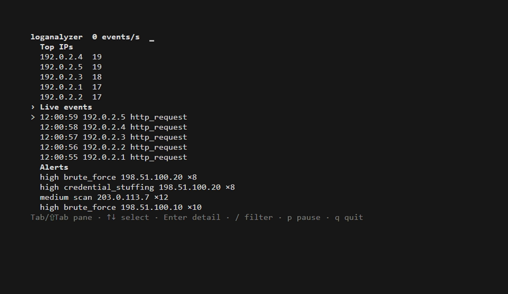
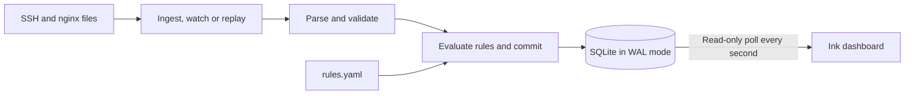

# loganalyzer

A personal project for educational purposes. Use it only with logs you own or have permission to analyze. All sample lines in this repository are generated.

Follow SSH and nginx logs, detect repeated login failures and web scans, and inspect the original lines in a terminal dashboard. The Python core counts malformed lines and stores normalized events and alerts in SQLite.



[Watch the recorded terminal demo](docs/media/dashboard.gif)

## Run the Docker demo

From a fresh checkout with Docker Engine and Compose installed, run

```sh
docker compose up
```

The demo generates two files, replays them at 5× speed and opens the Ink dashboard. After about 24 seconds the database contains 120 events and four alerts. The dashboard stays open for inspection.

For keyboard navigation, run `docker compose attach demo` in a second terminal. You can also start with `docker compose up -d --build` and then attach. Press `q` in the attached terminal to quit. Run `docker compose down` to remove the demo container. The database lives in a temporary in-memory filesystem inside the container. A new run starts fresh.

## Architecture



The writer commits events, alert changes and the live file offset together. A restart can continue from the last completed transaction. Each dashboard poll reads one consistent snapshot. The two processes can start independently because their only interface is the database.

## Ingest generated logs

For manual setup, install Python 3.12 and uv, then run `uv sync --locked` in the repository root.

```sh
uv run python scripts/generate_logs.py samples
uv run loganalyzer ingest samples/auth.log
uv run loganalyzer ingest samples/access.log
uv run loganalyzer stats
```

The generator replaces both files in the chosen directory. Each contains 60 events and one malformed line. Repeating an ingest resumes at the saved byte offset. Pass `--format auth` or `--format nginx` for a custom filename, and `--db PATH` to select a database. SSH times are interpreted as UTC, using the file modification time as the initial year reference. nginx timestamps include their own UTC offsets.

## Watch or replay a file

```sh
uv run loganalyzer watch samples/auth.log samples/access.log
uv run loganalyzer replay samples/auth.log --speed 10 --db demo.sqlite3
```

Watch checks each file every quarter second when idle. It waits for a newline before committing a record and prints session counts on Ctrl+C. Replay starts at the beginning on every invocation and appends events to the selected database. Use a fresh database for an independent demo. Playback preserves the stored timestamps and divides the gaps by the speed.

## Configure detection

Ingest reads `rules.yaml` from the working directory. Use `--rules PATH` to select another file. Each rule has a positive window length in seconds and a severity of `low`, `medium` or `high`.

| Rule | Condition for one IP within the window |
| --- | --- |
| brute_force | At least `threshold` failed SSH passwords |
| credential_stuffing | At least `threshold` distinct usernames in failed SSH passwords |
| scan | At least `missing_threshold` HTTP 404s or `paths_threshold` distinct request paths |

The generated sample produces four alert rows with the default rules. The sequence with eight usernames also qualifies as brute force. A rule change applies on subsequent ingestion. Existing alert rows retain their history.

## Open the dashboard

After ingesting the generated files, run these commands from the repository root with Node 20+ and npm installed.

```sh
cd tui
npm ci
npm run build
npm start
```

The default database is `../loganalyzer.sqlite3` relative to the TUI working directory. Use `npm start -- PATH` for another database. Running the dashboard first shows “waiting for daemon…” until ingestion creates the schema.

The header shows committed events per second over the last 20 samples. Top IPs ranks matching events by address. Live events are ordered by insertion, and alerts by their latest observation. Each pane holds up to 100 rows. Narrow or short terminals show the focused pane.

| Key | Action |
| --- | --- |
| Tab / Shift+Tab | Change pane |
| ↑ / ↓ | Select a row or scroll a detail |
| Enter | Inspect a row, including the raw log in Live events |
| Esc / Enter | Close detail |
| / | Edit a literal, case-insensitive filter. Enter applies it and resumes polling. Esc cancels. |
| p | Pause or resume polling |
| q | Quit |

Severity labels remain visible with `NO_COLOR=1`. From `tui/`, run `npm test`, `npm run lint` and `npm run typecheck` to check the terminal UI.

## Run the core tests

From the repository root, with Python 3.12 and uv installed, run

```sh
uv sync --locked
uv run pytest
uv run ruff check .
uv run mypy --strict
```

A synthetic batch crosses New Year in the parser tests. A storage test reopens a database and checks what survives a failed write. The walkthrough includes a runnable example and explains both cases. [Python walkthrough](docs/PYTHON_WALKTHROUGH.md)

## Ingestion benchmark

```sh
uv run pytest tests/benchmarks --benchmark-only
```

On Windows with Python 3.12.10 and an Intel Core i5-11400H, the median was **26,691 lines/s** across five runs of 5,000 generated nginx lines each. Median time was 187.33 ms. Mean time was 197.15 ms, or 25,361 lines/s.

The timer includes opening a fresh file-backed database per run, parsing, IPv4 validation, scan detection, alert updates and WAL commits in batches of 500. File generation and YAML loading happen before timing. The five client IPs request 47 paths and receive 404 responses. Storage and traffic mix affect the result.

## Record the dashboard

From the repository root with the TUI built and VHS, ttyd and FFmpeg on PATH, run

```sh
uv run python scripts/generate_logs.py samples
uv run loganalyzer ingest samples/auth.log --db samples/dashboard.sqlite3
uv run loganalyzer ingest samples/access.log --db samples/dashboard.sqlite3
vhs docs/media/demo.tape
```

Use a fresh recording database to reproduce the sample counts. The tape opens the dashboard, inspects an alert and filters for the generated scan address.

## Limits and ideas for later

- The SSH CLI assumes UTC and anchors missing years to file modification time. Copying an old archive can change that reference. A source-timezone and reference-date option would make historical imports easier.
- Watch can drain a renamed file while its old inode remains accessible under the original name plus a suffix. Compression, removal or moving the old file elsewhere can lose unread bytes. Copy-truncate rotation that regrows past the saved offset between polls can also escape detection.
- Rules detect per-IP patterns. Shared addresses can combine unrelated users, and a distributed attack can stay below each individual threshold.
- Event history grows until the database is archived. The dashboard ranks IPs over the matching history each second. Retention and a time-range filter would help with larger datasets.
